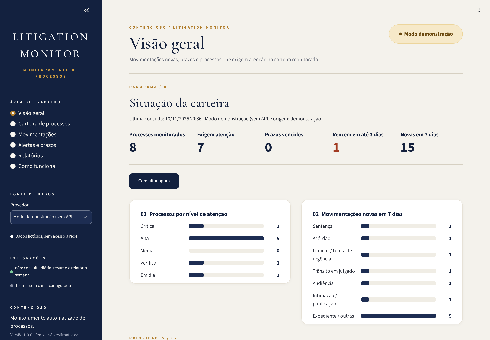
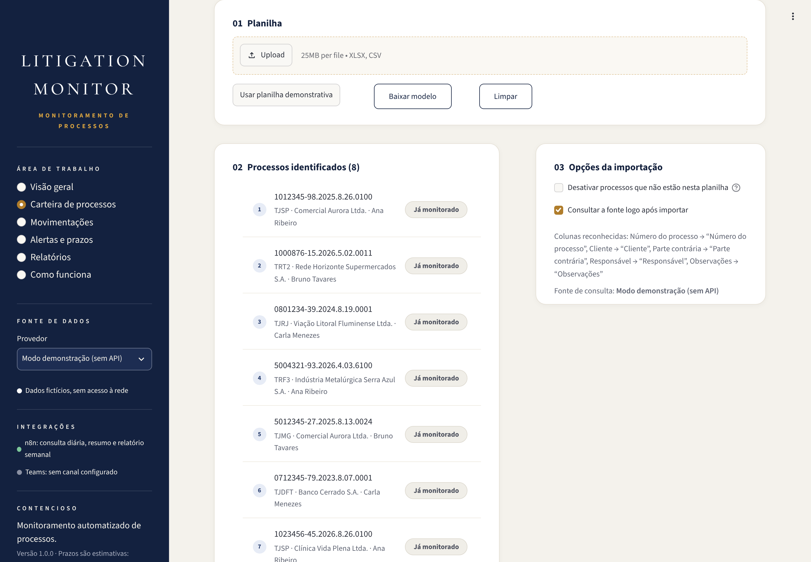
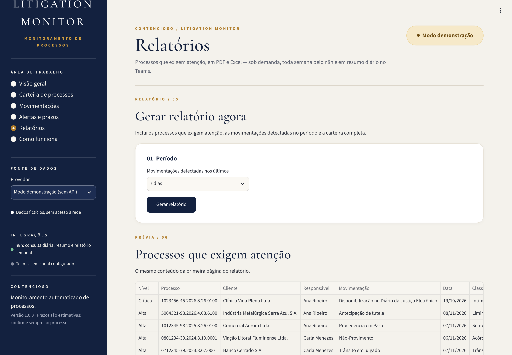
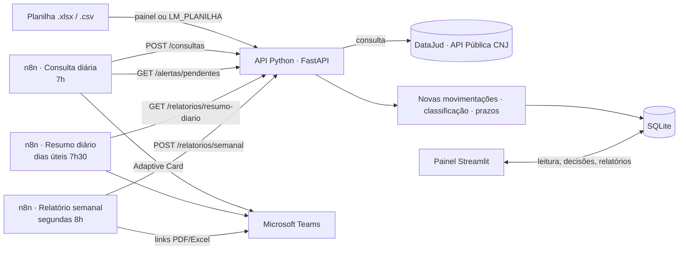

# LITIGATION MONITOR — Monitoramento automatizado de processos

Acompanhar processos exige consultar movimentações, identificar decisões importantes, monitorar prazos e atualizar
controles. O **LITIGATION MONITOR** automatiza esse caminho:

1. **Lê uma planilha** (Excel ou CSV) com os números dos processos e valida cada número (dígito verificador do CNJ).
2. **Consulta a API Pública do DataJud (CNJ)** — fonte oficial e autorizada — todos os dias, pelo n8n.
3. **Identifica as movimentações novas** desde a última consulta.
4. **Classifica** as relevantes: sentença, acórdão, liminar/tutela, audiência, intimação, citação, trânsito em
   julgado, decisões, suspensão e arquivamento.
5. **Estima prazos** em dias úteis (o analista confirma ou corrige no painel).
6. **Gera alertas** no Microsoft Teams e no painel sobre eventos importantes e prazos próximos ou vencidos.
7. **Atualiza o painel** de acompanhamento (Streamlit).
8. **Gera relatórios** dos processos que exigem atenção: resumo diário no Teams, relatório semanal em PDF + Excel e
   relatório sob demanda no painel.

> Projeto de portfólio/demonstração. O modo demonstração usa apenas dados fictícios. O DataJud expõe somente dados
> públicos (processos sem segredo de justiça).

## Telas



<table>
  <tr>
    <td width="50%"><br><sub><b>Carteira de processos</b> — leitura da planilha e validação dos números.</sub></td>
    <td width="50%"><br><sub><b>Movimentações</b> — nível de atenção, capa do processo, pendências e linha do tempo.</sub></td>
  </tr>
  <tr>
    <td width="50%"><br><sub><b>Alertas e prazos</b> — providência sugerida, confirmação do prazo e registro da decisão.</sub></td>
    <td width="50%"><br><sub><b>Relatórios</b> — PDF e Excel sob demanda, resumo diário e histórico.</sub></td>
  </tr>
</table>

<sub>Capturas geradas com os dados fictícios de <code>python -m litmonitor.seed</code>.</sub>

## Arquitetura



| Camada | Tecnologia | Onde |
|---|---|---|
| Processamento e regras | Python + pandas | `litmonitor/` |
| Fonte de dados autorizada | API Pública do DataJud (CNJ) · modo demonstração | `litmonitor/fontes.py` |
| Agendamento e notificações | n8n + Microsoft Teams | `n8n/workflows/` |
| Armazenamento | SQLite | `litmonitor/banco.py` |
| Relatórios | fpdf2 (PDF) · openpyxl (Excel) | `litmonitor/relatorios.py` |
| Painel | Streamlit | `painel/` |

## Como executar

### Com Docker Compose (recomendado)

```bash
cp .env.example .env                                # configure o webhook do Teams e a fonte
cp minha_carteira.xlsx planilhas/processos.xlsx     # opcional: planilha relida a cada consulta
docker compose up -d --build
```

| Serviço | Endereço |
|---|---|
| Painel | http://localhost:8501 |
| API (documentação interativa) | http://localhost:8000/docs |
| n8n | http://localhost:5678 |

Na primeira execução o serviço `n8n-importar` importa e ativa os três workflows. Ao abrir o n8n, crie a conta de
proprietário (pedida pelo próprio n8n). No painel, clique em **Carregar carteira demonstrativa** para conhecer as telas.

### Sem Docker (só painel e API)

```bash
python -m venv .venv && source .venv/bin/activate
pip install -r requirements-dev.txt
python -m litmonitor.seed                      # opcional: carteira fictícia
uvicorn litmonitor.api:app --port 8000         # API, para o n8n
streamlit run painel/app.py                    # painel
```

Sem o n8n, o botão **Consultar agora** do painel faz a mesma consulta. Para testar os três fluxos sem o n8n:

```bash
python scripts/simular_n8n.py consulta     # consulta + alertas
python scripts/simular_n8n.py resumo       # resumo diário
python scripts/simular_n8n.py semanal      # relatório semanal
```

## A planilha

| Coluna | Obrigatória | Exemplos de cabeçalho aceitos |
|---|---|---|
| Número do processo | sim | `Número do processo`, `Nº do processo`, `numero_cnj`, `Processo` |
| Cliente | não | `Cliente`, `Empresa` |
| Parte contrária | não | `Parte contrária`, `Adverso` |
| Responsável | não | `Responsável`, `Advogado` |
| Observações | não | `Observações`, `Obs` |

- O número pode vir com ou sem máscara (`0704252-62.2026.8.07.0021` ou `07042526220268070021`).
- Números com dígito verificador errado são listados e ignorados; números repetidos contam uma vez.
- Reimportar atualiza os dados cadastrais. A opção **desativar ausentes** pausa quem saiu da planilha (o histórico é mantido).
- Modelo: botão **Baixar modelo** no painel ou `exemplos/processos_exemplo.xlsx`.

## Fonte de dados: DataJud

A [API Pública do DataJud](https://datajud-wiki.cnj.jus.br/api-publica/) é mantida pelo CNJ e reúne metadados e
movimentos de processos de todos os tribunais (exceto STF), com os códigos da Tabela Processual Unificada (TPU).

- **Acesso:** gratuito, com a chave pública divulgada na wiki do CNJ. Ela já vem configurada; se o CNJ trocá-la,
  informe a nova em `DATAJUD_API_KEY`.
- **Tribunal:** identificado pelo próprio número (`J.TR`): `8.26` → TJSP, `5.02` → TRT2, `4.03` → TRF3…
- **Robustez:** a API às vezes responde com timeout (504) ou resultados parciais por sobrecarga; o cliente tenta de
  novo até 3 vezes com espera progressiva. Cada consulta leva de segundos a ~1 minuto.
- **Limites:** não traz o teor das decisões, a data marcada para audiências nem processos em segredo de justiça, e
  pode ter alguns dias de atraso em relação ao sistema do tribunal. Alguns tribunais enviam nomes de órgãos com
  caracteres trocados (`?`); o sistema mostra o dado como recebido.

No painel, troque a fonte em **Fonte de dados** (barra lateral). O **modo demonstração** simula a chegada de
movimentações a cada consulta, sem rede.

## Regras

**Novas movimentações** — cada movimento tem uma identidade (código, data/hora, grau e complementos). Na primeira
consulta de um processo, o histórico é gravado sem alertas; apenas eventos relevantes dos últimos 15 dias
(`LM_DIAS_RETROATIVOS`) contam como novos.

**Classificação** — por regras, sem IA e sem enviar dados a terceiros:

| Classificação | Como é identificada | Relevância | Prazo estimado |
|---|---|---|---|
| Sentença | julgamento (códigos TPU 193, 219–221, 466…) em 1º grau ou juizado | Alta | apelação: 15 dias úteis · juizado: recurso inominado, 10 dias úteis |
| Acórdão | provimento/não provimento (237–239…) ou julgamento em 2º grau/turma | Alta | REsp/RE: 15 dias úteis |
| Liminar / tutela | liminar, antecipação de tutela (339, 785…) | Alta | agravo de instrumento: 15 dias úteis |
| Trânsito em julgado | 848 | Alta | — |
| Audiência | 970 e subtipos; situação designada/realizada/cancelada | Alta (designada) | data a confirmar |
| Citação | documento do tipo citação | Alta | contestação: 15 dias úteis |
| Intimação / publicação | disponibilização no DJe (1061), publicação (92) | Média | 15 dias úteis (geral) |
| Decisão | outras decisões, interlocutória, saneamento, (in)deferimento | Média | — |
| Suspensão | suspensão/sobrestamento | Média | — |
| Arquivamento / baixa | 22, 245, 246… | Média | — |
| Expediente | conclusão, petição, juntada, remessa, mero expediente… | Baixa | — |

Quando a publicação no DJe chega até 5 dias depois de uma sentença, acórdão, liminar ou audiência, ela é **vinculada**
a esse evento (sem alerta duplicado) e o prazo passa a contar da publicação. Baixa e arquivamento logo após o
trânsito em julgado também são tratados como um só encerramento. A tabela de códigos foi conferida em movimentos
reais do DataJud e pode ser ajustada em `litmonitor/classificacao.py`.

**Prazos** — sempre **estimados**: dias úteis a partir do dia útil seguinte ao evento (CPC, arts. 219 e 224); no DJe,
publicação no dia útil seguinte à disponibilização (Lei nº 11.419/2006, art. 4º). Exclui fins de semana, feriados
nacionais, Carnaval, Sexta-feira Santa, Corpus Christi e o recesso de 20/12 a 20/01 (CPC, art. 220). **Não** considera
feriados locais nem suspensões de expediente: o analista confirma a data no painel, e prazo confirmado nunca é
recalculado.

**Nível de atenção do processo**

| Nível | Quando |
|---|---|
| Crítica | prazo vencido ou que vence em até 2 dias |
| Alta | evento de alta relevância pendente, audiência sem data confirmada ou prazo em até 5 dias |
| Média | evento de média relevância pendente |
| Verificar | processo não localizado ou falha na consulta |
| Em dia | nada pendente |

**Alertas (Teams e painel)**

| Alerta | Quando |
|---|---|
| Nova movimentação relevante | uma vez, para relevância ≥ `LM_RELEVANCIA_ALERTA` (padrão Média) |
| Prazo próximo | uma vez, a 3 dias ou menos (`LM_DIAS_ALERTA`); de novo se o prazo mudar |
| Prazo vence hoje | uma vez |
| Prazo vencido | a cada 24 h enquanto a pendência estiver aberta |
| Resumo diário | dias úteis, 7h30 |
| Relatório semanal | segundas, 8h, com links para o PDF e o Excel |

Uma pendência sai dos alertas quando o analista registra **Concluída** ou **Sem providência**.

## Configurando o Microsoft Teams

1. No canal: **⋯ › Workflows › “Post to a channel when a webhook request is received”** e copie a URL.
2. Informe-a em `TEAMS_WEBHOOK_URL` no `.env`.
3. Sem canal configurado, o alerta é registrado como “sem canal” e continua visível no painel.

Os cartões têm o botão **Abrir no painel** (`LM_URL_PAINEL/?processo=<número>`), que abre direto as movimentações do
processo. O cartão semanal aponta para `LM_URL_API/relatorios/<id>/pdf` e `/xlsx` — ajuste `LM_URL_API` para um
endereço acessível pela equipe.

## API

| Rota | Para quê |
|---|---|
| `POST /consultas` | relê a planilha (`LM_PLANILHA`, se houver) e consulta todos os processos ativos |
| `GET /alertas/pendentes` | alertas que ainda não foram enviados, com o cartão do Teams pronto |
| `POST /notificacoes` | registra o resultado do envio (`enviada`, `sem_canal`, `falha`) |
| `GET /relatorios/resumo-diario` | cartão do resumo diário |
| `POST /relatorios/semanal` | gera PDF + Excel e devolve o cartão com os links |
| `GET /relatorios/{id}/pdf` · `/xlsx` | download |
| `POST /processos/importar` | importa uma planilha em Base64 |
| `GET /processos` · `GET /saude` | consulta |

## Estrutura

```
litmonitor/           núcleo em Python
  cnj.py              número CNJ: validação, formatação e tribunal
  planilha.py         leitura da planilha com pandas
  fontes.py           DataJud (API Pública do CNJ) e modo demonstração
  classificacao.py    regras de classificação e vínculo intimação → evento
  calendario.py       dias úteis, feriados e recesso
  monitor.py          importação, consulta, prazos, nível de atenção e alertas
  teams.py            cartões (Adaptive Cards)
  relatorios.py       PDF, Excel e resumo diário
  banco.py · api.py · seed.py
painel/               Streamlit (app.py, estilo.py, componentes.py, paginas/)
n8n/workflows/        01_consulta_diaria, 02_resumo_diario, 03_relatorio_semanal
scripts/              gerador dos workflows e simulador do n8n
exemplos/             planilha fictícia (.xlsx e .csv)
tests/                pytest
```

## Testes

```bash
pip install -r requirements-dev.txt
pytest
```

Cobrem validação do número CNJ, calendário de prazos, classificação (inclusive com a estrutura real de resposta do
DataJud, novas tentativas e falhas), importação da planilha, detecção de novidades, alertas, API e relatórios.
